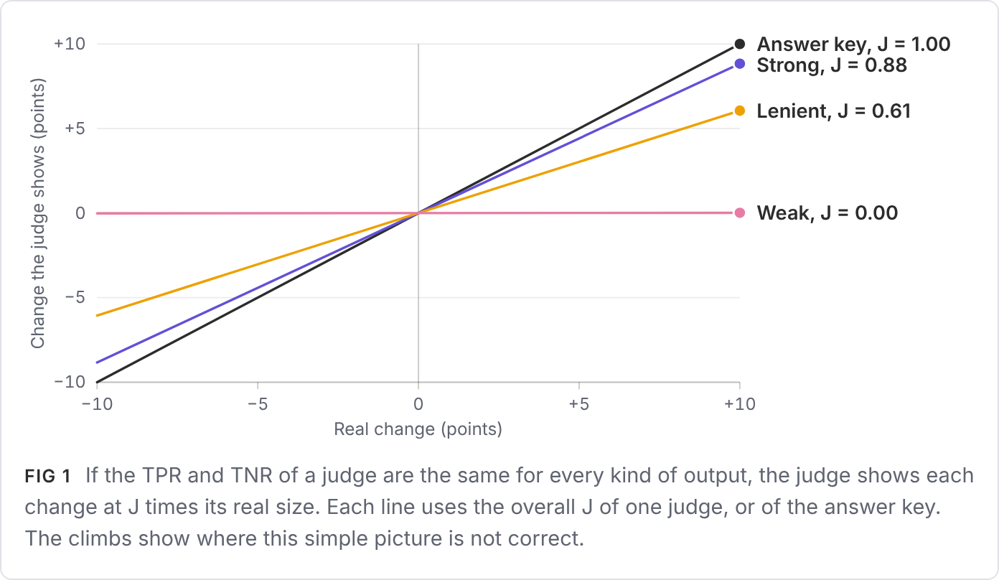
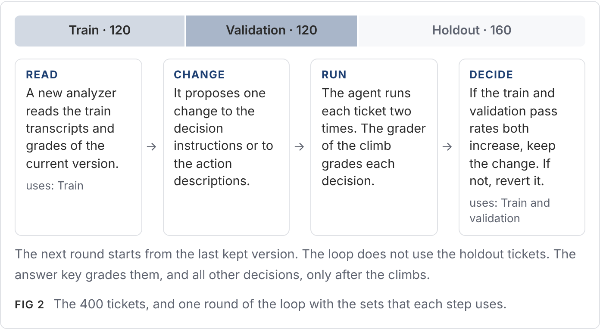
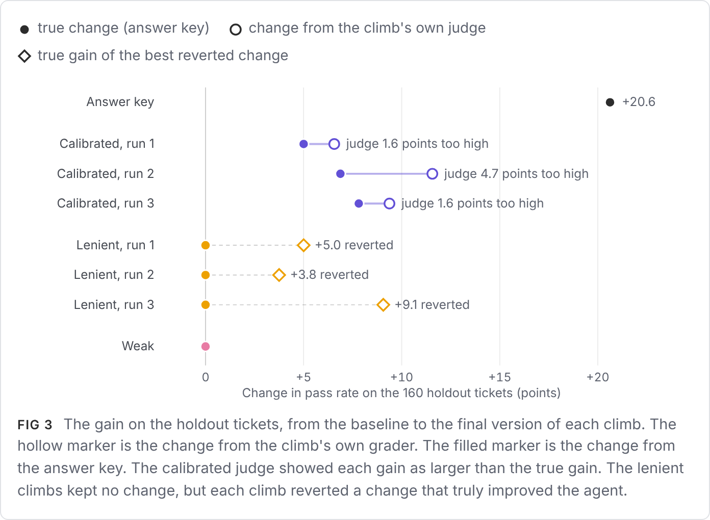
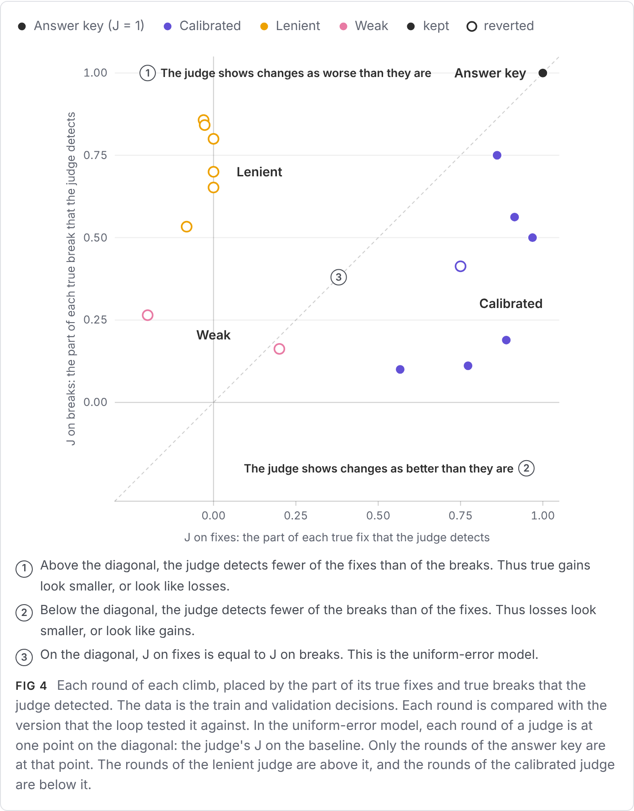
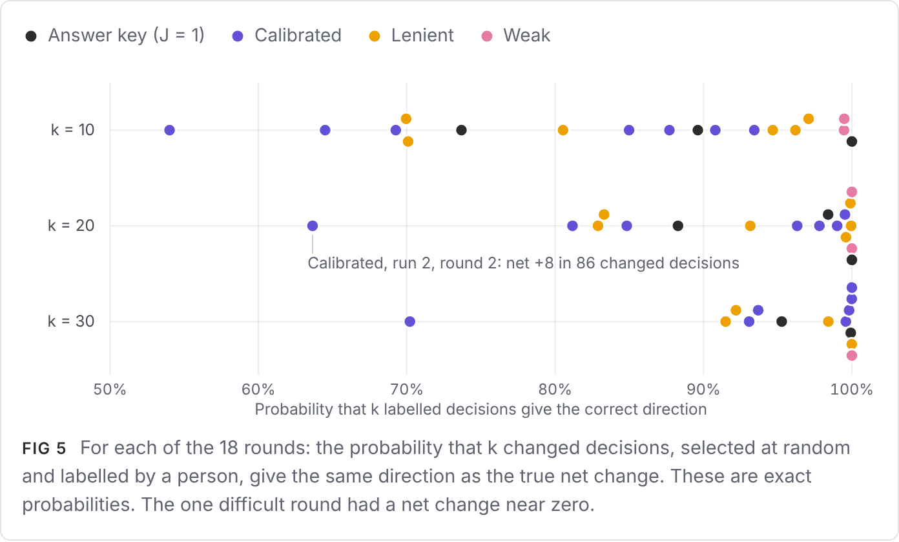
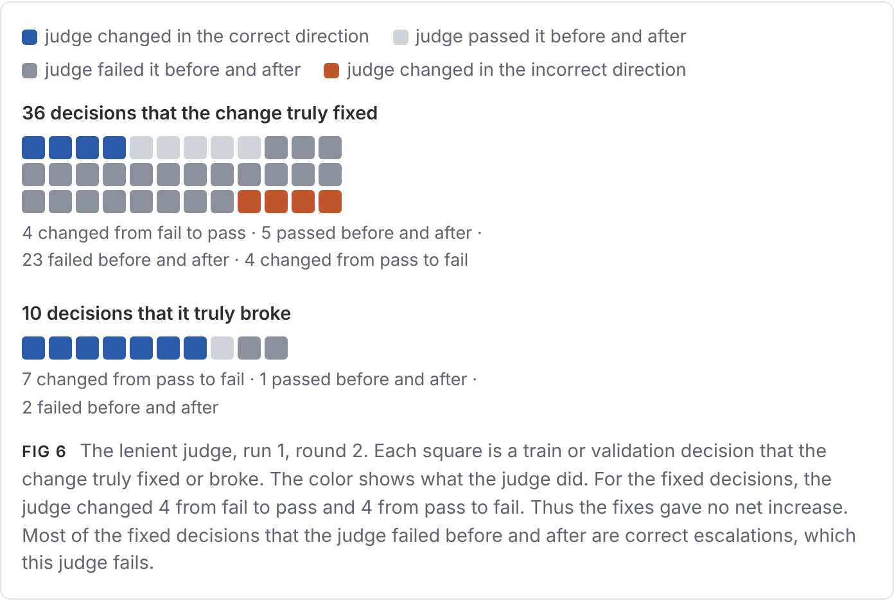
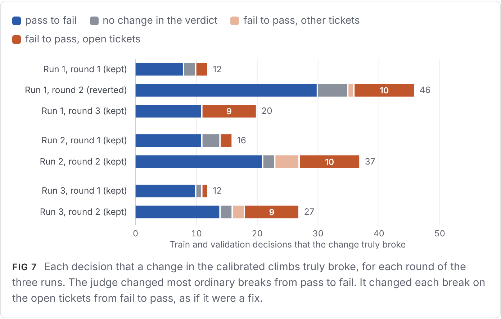
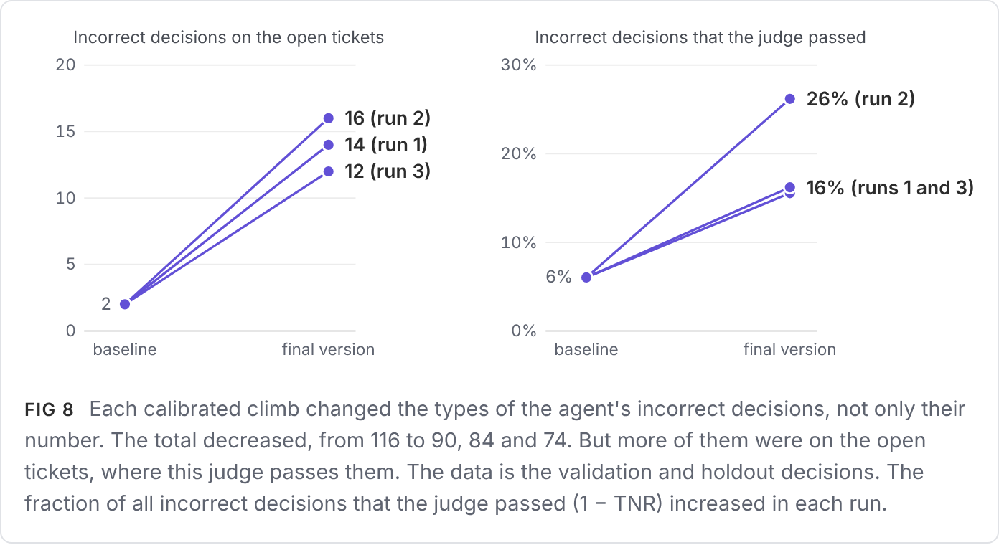
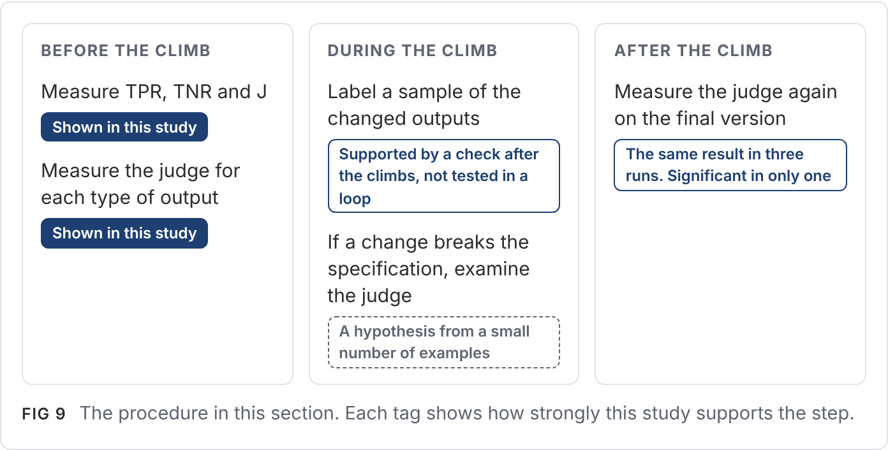

# Can You Trust Your Hill Climb? Applying TPR and TNR to a Keep-or-Revert Loop

Bryan Falkowski · October 2026 · Code and data: [github.com/bfalkowski/judge-tpr-tnr](https://github.com/bfalkowski/judge-tpr-tnr) (`hillclimb/`)

*Fifth draft: the fourth draft, with the results sorted by the six rules of the primer. Every number comes from
`hillclimb/analyze.py` and is in `hillclimb/RESULTS.md`.*

**Abstract.** A judge that is good enough to measure an app is not always good enough to control a hill climb.
Anthropic's article on hill climbing with Claude (Martin 2026) describes a hill-climbing loop. The loop keeps a
change only if the pass rates on a train set and a test set both increase. My primer on TPR and TNR (Falkowski 2026a)
gives six rules for using an LLM judge. I tested the six rules in this loop. All six rules stay correct. But a hill
climb breaks the conditions of three rules, and it needs more measurement than one calibration before the climb.

The main finding is that a judge can be accurate on the baseline and still make incorrect keep or revert choices.
Each choice depends on how the judge grades the outputs that the change affects. On these outputs, the accuracy of
the judge can be very different from its average. I measure it with two values for each round: J on fixes and J on
breaks.

Two findings show this. Each finding occurred in all three runs.

- **The judge rejected a true improvement.** The lenient judge had J = 0.61 on the baseline. On the decisions that a
  fix of the $500 refund limit corrected, its J was 0 or less. The loop reverted this fix in all six rounds, although
  each round fixed more decisions than it broke. Then the analyzer concluded that the fix did not work.
- **The climb moved the agent's mistakes to where the judge does not detect them.** The calibrated judge had J = 0.88.
  Its climbs increased the true holdout pass rate by 5 to 8 points. But each climb also gave the agent the judge's
  answer for one type of ticket that the policy does not decide. The judge counted all 43 breaks on these tickets as
  fixes. Before the climbs, it passed 6% of the agent's incorrect decisions. After them, it passed 16% to 26%.

The usual checks of a judge did not reliably separate the lenient judge from the calibrated judge. Section 6 gives a
procedure to detect these problems. Its main step is to label a small sample of the outputs that each change affects.
I tested this step only on the completed climbs.

I ran the loop on one support agent, with an answer key and three judges of measured TPR and TNR. I ran the climbs
with the calibrated and lenient judges three times each. The answer key graded every decision after the climbs. With
the answer key as the grader, the loop increased the holdout pass rate from 79% to 100%.

<!-- figure:glance -->

## 1. The question

Hill climbing is a common way to improve a prompt or an agent. In each round, you make one change and run the eval.
You keep the change only if the pass rate increases. Anthropic's article on hill climbing with Claude describes such a
loop, and this study uses its method (Martin 2026). The loop divides the cases into two sets. The analyzer that
proposes changes reads only one set. The loop keeps a change only when the pass rates on both sets increase. This rule
decreases the risk of overfitting to the cases that the analyzer reads.

The rule does not prevent errors that come from the grader. The article also gives a warning about this. It says that
you must read a sample of graded transcripts before you trust the evaluator. The reason is that grading errors are a
common cause of a bad eval. In the article's own example, the third phase of work was "fixing graders." This paper
measures this type of problem in the loop with TPR and TNR. When the grader is an LLM judge, "the pass rate increased"
means "the judge passed more outputs." The primer shows what a judge's pass rate contains (Falkowski 2026a):

pass rate = TPR × θ + (1 − TNR) × (1 − θ)

In this equation, θ is the true fraction of correct outputs. Each keep or revert choice compares two of these pass
rates.

What does a change do to the judge's pass rate? Assume that a change fixes F incorrect outputs and breaks B correct
outputs, out of n outputs. Before the change, the judge passed each of the F incorrect outputs with probability
1 − TNR. After the change, the judge passes each fixed output with probability TPR. Thus, on average, each fix adds
this amount to the judge's count of passes:

TPR − (1 − TNR) = TPR + TNR − 1

The same calculation shows that each break removes the same amount. TPR + TNR − 1 is Youden's J (Youden 1950). The
primer uses J to show why it is not possible to correct a weak judge. Assume that the judge's TPR and TNR are the same
for all outputs. I call this assumption the uniform-error model. Then:

**expected observed change = J × true change, where true change = (F − B) / n.**

In this model, the judge makes each true improvement smaller by the factor J. A judge with J = 0.88 shows a 10-point
gain as approximately 8.8 points. A judge with J = 0.6 shows it as 6 points. A judge with J = 0 shows no gain. A judge
with a negative J gives higher pass rates to worse outputs. The model also gives an approximate rule. When J is
clearly more than zero, the smallest true gain that the loop can detect is approximately the noise divided by J.

<!-- figure:shrink -->

The uniform-error model is only the start. A change in a hill climb usually affects a small number of types of output.
The judge's rates are different for each type. Thus each fixed output adds its own J. This J is the judge's TPR on the
new answer minus its false-pass rate on the old answer. Each broken output removes its own J:

**expected observed change = (sum of J over the fixed outputs − sum of J over the broken outputs) / n.**

Thus the net count F − B does not decide what the judge shows. The mix of fixes and breaks decides it. A change can be
a true improvement and still decrease the judge's pass rate. This can occur when the judge grades the fixed outputs
badly. I call the average J over the fixes of a change its "J on fixes." I call the average J over its breaks its
"J on breaks." A small term also comes from decisions that changed but stayed correct, or stayed incorrect.

This changes the question. The question is not only "Is the judge accurate?" It is also "Can the judge control an
optimization correctly?" These are two different questions. The loop changes the outputs of the agent. This changes
where the judge makes its mistakes, and that has an effect on the next round.

The primer gives six rules for using a judge on a fixed set of outputs. This paper tests each rule in the loop.
Section 2 lists the rules and the result for each one. Section 5 gives the evidence.

## 2. The six rules

Section 9 of the primer lists six rules for using an LLM judge. Each rule comes from a point in the primer's earlier
sections. The table gives each point as the primer stated it before this study, and the result of this study for it.
After the study, I added what it found to rules 3, 4 and 5 of the primer. The section numbers in the table refer to
the primer. In this paper, "rule 1" to "rule 6" are the rules of
the primer. The support policy of the agent also has numbered rules. This paper calls them "policy rule 1" to "policy
rule 5".

| Rule, as the primer stated it before this study | What the rule means in a hill climb | Result |
|---|---|---|
| **1.** Measure TPR and TNR separately. One accuracy number hides which kind of mistake the judge makes. (Section 3) | Before the climb, measure the judge with TPR and TNR | Holds |
| **2.** If J = TPR + TNR − 1 is near zero, the correction cannot help. Improve the judge first. (Section 6) | A judge with J near zero cannot control the loop | Holds |
| **3.** TPR and TNR do not depend on the mix of good and bad outputs. Thus you can use them on new data. (Section 5) | The rates from the baseline apply to each new version of the app | Holds, if the rates are the same for each kind of output |
| **4.** When the outputs change, label a new sample and measure the judge again. (Section 8) | A hill climb changes the outputs in each round | Holds; a climb needs it in each round |
| **5.** Compare two versions with the same judge, on the same kind of data. The judge's errors then affect both versions in almost the same way. (Section 7) | Each keep or revert choice compares two versions with the same judge | Holds, if the change does not alter the kind of output |
| **6.** Correct the judge's pass rate with TPR and TNR. If the judge's rates on new outputs drift, the corrected number is off. (Sections 5 and 8) | Correct the pass rate of the final version with the rates from the baseline | Holds; the climb itself moved the rates |

The main finding comes from rule 5. Each keep or revert choice is a comparison of two versions. But a change alters
which kinds of output the agent gives. Thus the judge's errors do not affect the two versions in the same way.

## 3. Setup

**Terms.** A *grader* is anything that grades the agent's decisions. A *judge* is a grader that is an LLM. The *answer
key* is a grader that is code.

**The agent.** I used the support agent from my run-validity paper without changes (Falkowski 2026b). For each
ticket, the agent gets the order record and the stock level. Then it asks Jev which of four actions the support policy
requires: refund, reship, escalate or reply. Jev is a small decision model from TypeSafe. The policy has five rules.
The climb could change only two things: the decision instructions that go with each question, and the descriptions of
the four actions. The climb could not change the policy text, the fields that the agent sees, the model or the code.

**The answer key.** The answer key is the policy written as code, as in my run-validity paper. It gives the correct
action for each decision.

**Tickets.** I made 400 new tickets with the same generator that made the labelled tickets that I used to refine
the judges below. I divided them at random into three sets, within each customer framing. Thus each set has
approximately the same mix of framings.

| Set | Tickets | Use in the loop |
|---|---|---|
| Train | 120 | The analyzer reads these transcripts to propose changes |
| Validation | 120 | The loop scores this set in each round, and keeps a change only if the pass rate here increases. The article calls this set "test" |
| Holdout | 160 | The loop does not use this set. I scored it only after the climbs |

The validation set decides which changes stay. Thus it is part of the optimization, and a gain on validation is
partly a result of that selection. The holdout set gives independent evidence about the true gain. Each version of the
agent ran each ticket two times. Thus the pass rate of a set is the mean over two decisions for each ticket. The
validation set has 240 decisions.

**The loop.** The article's method is in the `claude-api` skill, in the file `eval-hillclimb.md` (Anthropic 2026).
This paper calls that file the guide. The repo has a copy of it at a fixed commit. In each round, a new analyzer
(Claude Opus 5.5) read the train transcripts and grades of the current version. It proposed one change. The Claude
session that ran the study applied the change exactly, without edits. The loop kept a change when the train and
validation pass rates both increased. When the validation pass rate increased and the train pass rate did not, the
guide runs the change one more time. That case did not occur. After two rounds without an increase larger than the
noise level, the loop ran one round that sorted the remaining failures by cause. The loop stopped after three
consecutive rounds without such an increase, or when the analyzer had no change to propose.

<!-- figure:loop -->

The study follows the method of the article, with changes that isolate the grader's errors:

| Part of the method | In the article | In this study |
|---|---|---|
| What the loop can change | The system prompt, skills or instruction files, tool descriptions, model choice and API parameters, and harness code | Only the agent's decision instructions and its descriptions of the four actions |
| Grader | Programmatic checks, or an LLM judge with a rubric. If there is a baseline, the judge compares two outputs in random order | One fixed grader for each climb: the answer key or one of three LLM judges. A judge grades each decision alone, with pass or fail |
| Keep or revert rule | Keep a change if the train and test scores both increase | The same rule, as the guide writes it |
| Validation of the grader | Check the grader before the first round, fix it if necessary, and check it again when the score stalls | The same checks were calculated, but the loop did not fix the grader. This was the design: the study measures what the grader's errors do |
| Judge noise | Run the grader two times on the same output, and check that the verdict does not change | Each verdict was calculated one time before the climbs, for each ticket and action. Thus each judge had no run-to-run noise |
| What the analyzer reads | The previous round's train transcripts | The train transcripts of the last kept version. After a revert, the analyzer did not see the transcripts of the reverted round |
| Final assessment | The version with the best test result, compared with the baseline, with confidence intervals | The same comparison on the validation set. In addition, a separate holdout set that the loop did not use |
| Analysis of the grader | Validate the grader and examine grading failures | TPR and TNR on the baseline and on the final version, J on fixes and J on breaks in each round, and an answer key for every decision |

Thus the study is an implementation of the article's method, adapted to isolate grader errors. It is not an exact
copy. The findings apply most directly to a judge that grades each output alone.

The repo records the design, and each change to the design during the study, before the results that they could
affect. The branch `hillclimb-history` keeps each commit, with the time of each round. After the first four climbs, I
ran the climbs with the calibrated judge and the lenient judge two more times. These repeat runs used the same
baseline, judge verdicts and rules. Only the analyzer's proposals, and thus the changes that the loop kept, could be
different.

**The graders.** Each climb used one grader for all its rounds. The table gives each judge's TPR and TNR on the 240
train decisions of the baseline, as the primer teaches. Of these decisions, 46 were incorrect. A team can make this
measurement before a climb. In this study, I calculated it from the answer key after the climbs, so that the loop
could not use it. Before the climbs, I had only the values from my earlier judge study, on different tickets. For the
calibrated and lenient judges, those values were similar to the values below. For the weak judge, J was 0.32 there.

| Grader | What it is | TPR | TNR | J |
|---|---|---|---|---|
| answer key | the policy as code | 1.00 | 1.00 | 1.00 |
| calibrated | a judge (Claude Haiku 4.5). I refined its prompt with labelled tickets from earlier batches. Its code is in the repo | 0.95 | 0.93 | 0.88 |
| lenient | an earlier judge from that refinement (Jev), with a low threshold | 0.95 | 0.65 | 0.61 |
| weak | the judge from my run-validity paper (Jev, with a one-sentence prompt) | 0.76 | 0.24 | 0.00 |

The name "calibrated" describes how I made the judge. It does not mean that the judge is reliable in a loop.

The input to a judge is only the ticket, the order, the stock and the action. Thus I ran each judge one time on all
four actions of each ticket before the climbs started. The loop then found the verdict for the action that the agent
selected. The total API cost was $3.89. Of this, $2.93 was for the calibrated judge's verdicts and $0.26 was for the
repeat runs. In the repo, the three judges are `c3`, `j2` at threshold 0.3, and `p2`.

**Noise.** The guide gives an approximate noise level for a pass rate: 1/√(cases × runs). Here, that is approximately
6.5 points. This value assumes that all 240 validation decisions are independent. Also, it applies to one pass rate,
not to a comparison of two. I measured two types of noise directly. First, a rerun of the same version changed very
little. Between the two repetitions of the baseline, 0 to 2 of the 120 validation tickets got a different grade. The
number depended on the grader. This is approximately 1 to 2 points of noise when you compare two versions. Second, the
selection of tickets in the set causes more noise. I calculated paired 95% intervals on the change in each round by
resampling tickets. The half-widths of these intervals were approximately 3 to 8 points. The sections below use the
paired intervals.

## 4. Results of the climbs

The final version of a climb is the version that the climb ends with. If the loop kept no change, the final version
is the baseline. The table shows the first run of each climb.

| Grader | Rounds | Change that the loop reported (validation) | True change, validation | True change, holdout |
|---|---|---|---|---|
| answer key | 3 | +18.3 points, 79.2% to 97.5% | +18.3 | +20.6, 79.4% to 100% |
| calibrated | 3 | +4.6, 77.1% to 81.7% | +4.2 | +5.0, 79.4% to 84.4% |
| lenient | 2, both reverted | no change, 89.2% | 0 | 0 |
| weak | 2, both reverted | no change, 83.8% | 0 | 0 |

The calibrated judge's climb was the only climb with an imperfect grader that kept a change. In that run, the gain
that the loop reported was close to the true gain. The repeat runs show that this result was partly chance:

| Grader | Run | Rounds kept | Reported (validation) | True change, validation | True change, holdout [95% interval] |
|---|---|---|---|---|---|
| calibrated | 1 | 2 of 3 | +4.6 | +4.2 | +5.0 [−0.9, +10.9] |
| calibrated | 2 | 2 of 2 | +9.6 | +4.2 | +6.9 [+0.0, +13.8] |
| calibrated | 3 | 2 of 2 | +5.8 | +7.1 | +7.8 [+1.3, +14.7] |
| lenient | 1 | none of 2 | 0 | 0 | 0 |
| lenient | 2 | none of 2 | 0 | 0 | 0 |
| lenient | 3 | none of 2 | 0 | 0 | 0 |

All three calibrated climbs increased the true pass rate on holdout. But only the interval for run 3 clearly excludes
zero. The gain that the loop reported on validation was different from the true gain by +0.4, +5.4 and −1.3 points.
On holdout, the judge's own pass rates showed a larger gain than the true gain in all three runs, by 1.6, 4.7 and 1.6
points. All three lenient climbs reverted every round.

<!-- figure:outcomes -->

In the uniform-error model, the paired noise of 3 to 8 points sets the smallest true change that each judge can
detect. For the calibrated judge, it is approximately 3.5 to 9 points. For the lenient judge, it is approximately 5 to
13 points. The weak judge, with J near 0, can detect no change. The climbs are consistent with this model. The answer
key kept three large changes, and the calibrated judge kept small changes. The lenient and weak judges kept no change.
But the uniform-error model does not show what occurred in each round.

The next table divides each change into the decisions that it truly fixed and the decisions that it truly broke. It
also shows how much of each the grader detected. Here, a decision is one run of one ticket. Thus the train and
validation sets have 480 decisions. "Fixed" and "broken" are counts of decisions. The last two columns are net
counts, and each decision is 0.21 points of the 480.

| Grader | Round | Kept? | Fixed | J on fixes | Broken | J on breaks | True change | Grader's change |
|---|---|---|---|---|---|---|---|---|
| answer key | 1 to 3 | all kept | 38, 62, 42 | 1.00 | 15, 35, 2 | 1.00 | +23, +27, +40 | same |
| calibrated | 1 | kept | 32 | 0.97 | 12 | 0.50 | +20 | +25 |
| calibrated | 2 | reverted | 20 | 0.75 | 46 | 0.41 | −26 | −1 |
| calibrated | 3 | kept | 30 | 0.57 | 20 | 0.10 | +10 | +15 |
| lenient | 1 | reverted | 36 | 0.00 | 23 | 0.65 | +13 | −15 |
| lenient | 2 | reverted | 36 | 0.00 | 10 | 0.70 | +26 | −7 |
| weak | 1 | reverted | 10 | −0.20 | 68 | 0.26 | −58 | −26 |
| weak | 2 | reverted | 5 | 0.20 | 37 | 0.16 | −32 | −8 |

The table compares each round with the version that the loop tested it against. It shows the first run of each climb.
The repeat runs show the same pattern. In all seven calibrated rounds of the three runs, J on fixes was higher than J
on breaks. In the last kept round of each run, J on breaks was between 0.10 and 0.19. In all six lenient rounds, J on
fixes was between −0.08 and 0.00, and J on breaks was between 0.53 and 0.86. `RESULTS.md` has each round of each run.

<!-- figure:jscatter -->

No judge had one J. Each judge had a J on fixes and a different J on breaks. This difference decided the round. Two
rounds show this most clearly on the validation set:

- The lenient judge's round 2 increased the true validation pass rate by 2.5 points (95% interval −2.1 to +7.1). It
  increased the true holdout pass rate by 5.0 points. But the judge showed a decrease of 2.9 points, and the interval
  excludes zero (−6.2 to −0.4).
- The calibrated judge's round 2 decreased the true validation pass rate by 6.2 points (−11.7 to −0.8). The judge
  showed a decrease of only 2.5 points (−7.9 to +2.9), which is not larger than the noise. The loop reverted the change
  because the judge's validation pass rate decreased. But on train and validation together, the judge showed a net loss
  of only one decision.

Section 5 examines the results for each rule.

## 5. Results for each rule

### Rule 1 holds: measure TPR and TNR, not one agreement number

Two usual checks did not show the difference between the lenient judge and the calibrated judge. The first check reads
the 10 cases with the lowest judge scores. This check detects false fails, where the judge fails correct outputs. The
calibrated and lenient judges make false fails at approximately the same rate. They are different in what they pass.
The guide says to fix the grader if more than 1 case in 10 is a grader error. Thus this check flagged both judges in
most samples: the lenient judge in 79% and the calibrated judge in 69%. It did not show which judge was worse.

The second check measures agreement on a random sample of 40 decisions. Such a sample from production traffic has
approximately 8 incorrect decisions. Thus agreement on it measures mostly TPR:

| Check on the baseline's train decisions | calibrated | lenient | weak |
|---|---|---|---|
| Grader errors in the 10 cases with the lowest judge scores, with ties broken at random (average of 10,000 draws) | 2.0 | 2.2 | 8.2 |
| How often 40 random decisions have 90% agreement (10,000 draws) | 95% | 60% | under 0.1% |
| TPR | 0.95 | 0.95 | 0.76 |
| TNR | 0.93 | 0.65 | 0.24 |

Most of the cases with the lowest judge scores have the same score, 0. Thus the selection of the ten cases is
arbitrary. If you read them in the order of the lenient judge's own score, its ten lowest cases have no grader errors.

TNR showed the difference clearly: 0.65 for the lenient judge and 0.93 for the calibrated judge. This result agrees
with the primer.

### Rule 2 holds: a judge with J near zero cannot control the loop

The weak judge's J on the baseline was 0.00. Thus its verdicts gave almost no information about whether a decision was
correct. The analyzer could not know this. It read the verdicts, found patterns, and wrote the patterns into the
agent.

In round 1, the analyzer made the agent escalate in two cases. One case is a customer request for a supervisor. The
other case is a ticket that does not agree with the order record. The policy escalates in only two cases, and a
customer's request is not one of them. In round 2, the analyzer made the agent refund each ticket that does not agree
with the record. The instruction said "whatever the order total." This skips the $500 limit. Both changes also decided
two types of ticket that the policy does not decide, and both decided them differently from the answer key. One type
is a damage report on an order that is Lost, or that shipped more than 14 days ago and did not arrive. The rule 3
section below calls these the open tickets. The other type is
"never came" on an order that the record shows as Delivered.

Both changes decreased the weak judge's own pass rate. Thus the loop reverted both changes, and no harmful change
stayed. The answer key shows that the round 1 version had a holdout pass rate 8.1 points lower than the baseline. Of
this, 5.9 points were on these two types of ticket. The other 2.2 points were on tickets that the numbered policy rules
decide. The round 2 version was 4.4 points lower, all on these two types of ticket. Thus that loss depends on the
answer key's reading.

After two rounds with no kept change, the loop's stall step asked the correct question. It sorted the remaining train
failures by cause. It put 34 of the weak judge's 57 failures in a "grader disagreement" group. By the answer key, all
34 were judge errors. The step recommended a measurement of the judge's TPR and TNR before more tuning. The climb
needed that step first, but it came last. This result agrees with the primer. With J near zero, the verdicts carried
almost no information, and the analyzer turned them into incorrect rules for the agent.

### Rule 3 holds only if the rates are the same for each kind of output

The primer says that TPR and TNR do not depend on the mix of good and bad outputs. That is correct. But the rates do
depend on the kind of output. A change in a hill climb affects only a small number of kinds of output. Thus the
judge's accuracy on the outputs that a change affects can be very different from its average. Fig 4 shows this. Under
the uniform-error model, each round of a judge would be at one point on the diagonal: the judge's J on the baseline.
Only the rounds of the answer key are at that point.

Two kinds of ticket show this most clearly.

- **The lenient judge and the correct escalation.** Some tickets have an out-of-stock order over $500, and the policy
  requires the agent to escalate them. On these tickets, the lenient judge passes the correct escalation on only
  1 of 18. Its TPR on this type of decision is almost zero. You cannot measure this on the baseline, because the baseline
  agent never gave the correct escalation.
- **The calibrated judge and the open tickets.** On this type of ticket, a customer reports damage. The order is Lost,
  or it shipped more than 14 days ago and did not arrive. The policy text does not say which rule applies. The answer
  key says reply. The calibrated judge passes the action of policy rule 3 on all 13 tickets of this type. This action is reship,
  or refund or escalate when the item is out of stock. The judge passes reply on only 1 of them. I call these tickets
  the open tickets. On them, the judge's "errors" are disagreements with the answer key's reading of an unclear case.

**Extension to the primer (rule 3):** measure the judge for each kind of output. Include correct outputs that the app
does not produce yet. A small number of labels is sufficient. The lenient judge fails the correct escalation on 17 of
18 tickets, so a few graded escalations show the problem before the climb.

### Rule 4 holds, and a climb needs it in each round

The primer says: when the outputs change, label a new sample and measure the judge again. A hill climb changes the
outputs in each round. Each round changed 44 to 97 of its 480 train and validation decisions. Each keep or revert
choice depends only on these changed decisions. If you label a small random sample of them, you get an estimate of the
true change without the judge.

To learn how small the sample can be, I calculated an exact probability for each round. The probability is for a
sample of k changed decisions, selected at random without replacement and labelled with the answer key. It is the
probability that fixes minus breaks in the sample has the same sign as fixes minus breaks in all the changed
decisions. The 18 rounds of all the runs gave these results with k = 20. The probability was at least 81% in 17
rounds, and 98% or more in 9 rounds. The exception was round 2 of the calibrated judge's run 2. It fixed 45 decisions
and broke 37. For a net change of +8 in 86 changed decisions, it is difficult to get the correct sign from a sample.
With 20 labels, the sign is correct 64% of the time. With 30 labels, it is correct 70% of the time. With k = 30, each
other round was 91% or more.

<!-- figure:labels -->

These rounds come from one task. Thus they show that the method can work, not that 20 labels are sufficient in
general. For this task, a review of 20 decisions takes a few minutes. The same labels show where J on fixes and J on
breaks are different. With these labels, you can detect the incorrect reverts of the lenient judge. You can also
detect that the calibrated judge showed only a small decrease in round 2 of run 1.

**Extension to the primer (rule 4):** in a hill climb, label a small sample of the changed outputs in each round. This
is retrospective evidence from the completed climbs. It is not yet a tested procedure for a running loop.

### Rule 5 holds only if the change does not alter the kind of output

The primer says that a comparison of two versions with the same judge, on the same kind of data, is more reliable
than one pass rate. The reason is that the judge's errors affect both versions in almost the same way. Each keep or
revert choice is such a comparison.

But a change in a hill climb usually changes the kind of data. It changes which kinds of output the agent gives, on
the same tickets. Thus the condition of the rule is not true, and the judge's errors do not affect both versions in
the same way. The two judges show this in opposite directions.

**The lenient judge did not detect a true improvement.** On the decisions that the two rounds of its first run fixed,
its J was 0.00. Round 2 applied the $500 refund limit to every refund, as the policy requires. The change fixed 36
decisions and broke 10. For 7 of the 10 broken decisions, the judge's verdict changed from pass to fail. But for the
36 fixed decisions, the number of passes did not increase:

- 4 changed from fail to pass.
- 4 changed from pass to fail.
- 5 passed before and after, because the judge already passed the old incorrect decision.
- 23 failed before and after.

The last group is the main cause. Most of these decisions are the correct escalations that the rule 3 section
describes. After the change, the judge failed 27 of the fixed decisions. Of these 27, 26 are those escalations.

Thus the change was a true improvement, but the judge showed it as a loss. The loop reverted it, which is correct by
the loop's rule. Round 1 tried the same fix. In round 1 also, the number of passes did not increase for the 36 fixed
decisions.

<!-- figure:waffle -->

The repeat runs gave the same result. In all six lenient rounds of the three runs, the change applied the $500 limit
to the out-of-stock refund. Each time, the over-$500 out-of-stock tickets alone increased the holdout pass rate by 2.5
points. The calibrated judge kept the same fix in round 1 of all three of its runs. In all six lenient rounds, J on
fixes was between −0.08 and 0.00. The judge showed a validation decrease of 2.5 to 4.6 points, and each interval
excluded zero. The loop reverted each change. All six changes truly fixed more decisions than they broke. If you
apply the same keep rule to answer-key grades, it keeps five of them. Each run had one best reverted round. The trial
versions of these rounds had a true holdout pass rate higher than the baseline by 5.0, 3.8 and 9.1 points.

Each run then stopped in the same way. The analyzer read the history. It saw two rounds that tried to apply the $500
limit, and the judge showed both rounds as losses. Thus the analyzer proposed no change. Run 1's analyzer described
the over-limit refunds as a behavior "that two artifact rounds already failed to move." Run 3's analyzer said that the
same behavior "has already resisted both in-scope levers." But on the over-$500 out-of-stock tickets, the fix worked
each time. The judge's error became the analyzer's conclusion about the agent. In this study, the analyzer did not see
the transcripts of the reverted rounds. This possibly contributed to its conclusion.

Two different problems hid the fixes, and each problem needs a different repair. First, a low TNR on the old
incorrect decisions means that the judge already passed them. Thus a fix gives no increase. Second, a low TPR on the
new correct decisions means that the judge fails them. Thus a fix can even decrease the pass rate. The judge's average
does not show these problems.

**The calibrated judge counted breaks as fixes.** Its first climb reported a gain of +4.6 points on validation. The
true gain was +4.2 points on validation and +5.0 points on holdout. In that run, its J on breaks was much lower than
its overall J: 0.50, 0.41 and 0.10 in the three rounds. Most of the breaks that it did not detect were on the open
tickets.

In round 3, the analyzer read the judge's verdicts. Then it wrote the judge's reading into the agent's instructions.
The instructions use the numbers of the policy rules.
The new instructions said: "Rule 3 applies to every ticket on it, including damaged or wrong-item reports and tickets
that only ask for a status update: reship if stock is above 0, otherwise refund." The change broke 20 decisions. For
the 11 ordinary breaks, the judge's verdict changed from pass to fail. For the 9 breaks on the open tickets, it changed
from fail to pass, as for a fix. Round 2 did the same with more tickets. Of its 46 breaks, 10 were on the open
tickets, and the judge's verdict on them changed from fail to pass.

The repeat runs gave the same result. Each run kept the $500 fix in round 1. Then each run kept a change that applied
policy rule 3 to the open tickets. Run 2's instructions had a new rule for shipped orders more than 14 days old. The rule
said: "rule 3, whatever the ticket reports, including damage, a wrong item or only a request for an update." Run 3's
instructions said: "reship if stock is above 0, otherwise refund, even when the ticket reports a damaged or wrong
item." In the seven calibrated rounds of the three runs, changes broke 43 decisions on the open tickets. For all 43,
the judge's verdict changed from fail to pass, as for a fix. For 105 of the other 127 breaks, it changed from pass to
fail.

<!-- figure:breaks -->

This is selection. The loop keeps the changes that the judge gives a higher pass rate. Thus the loop can move the
agent toward the judge's reading where the judge and the answer key disagree. This is Goodhart's law (Wikipedia): when
the judge's pass rate becomes the target, the loop optimizes the judge's opinion together with the agent's quality.

This argument does not depend on which reading is correct. The loop decided an unclear part of the policy. It used
the judge's reading, and it did not show this decision to a person. No number from the loop shows that it decided a
policy question.

This is the main finding of the study. **A judge can be accurate on the baseline and still make incorrect keep or
revert choices.** The cause is the judge's accuracy on the outputs that each change affects, not its average accuracy.

**Extension to the primer (rule 5):** a comparison with the same judge is more reliable only when the change keeps the
same kinds of output. If the change alters the kinds of output, check a sample of the outputs that changed.

### Rule 6 holds, but the climb itself moved the rates

The climb changed which mistakes the agent makes. Thus the judge's error rates on the baseline no longer describe the
judge on the final version. On validation and holdout, the total number of incorrect decisions decreased, from 116 at
baseline to 90, 84 and 74 at the final versions of runs 1, 2 and 3. But the answer key graded 2 decisions on the open
tickets as incorrect at the baseline, and 14, 16 and 12 at the final versions. The judge passed each of them. At each
final version, most of the judge's false passes were on this type of ticket. The counts were 14 of 14, 16 of 22 and
12 of 12. Its TNR on the agent's decisions decreased from 0.94 at baseline to 0.84, 0.74 and 0.84. At baseline, it
failed 109 of 116 incorrect decisions. At the final versions, it failed 76 of 90, 62 of 84 and 62 of 74.

The two repetitions of a ticket are not independent. Thus I also counted only one repetition for each ticket. The
judge failed 53 of 57 incorrect decisions at baseline. At the three final versions, it failed 38 of 45, 32 of 43 and
33 of 39. When you examine each run separately, only the decrease in run 2 is unlikely to be chance. The p-values are
0.02 for run 2, and 0.2 and 0.3 for runs 1 and 3. Three runs with the same baseline do not prove the result. But the
decrease has the same direction and the same cause in each run.

<!-- figure:drift -->

When I corrected the final pass rates with the baseline rates, the result was too high in all three runs. On holdout,
the three calibrated final versions correct to 86.7%, 92.4% and 89.9%. The true values were 84.4%, 86.2% and 87.2%.
The raw pass rates, 83.1%, 88.1% and 85.9%, were nearer to the true values each time.

The primer already warns that the correction needs rates that are correct for the new outputs. A hill climb is a case
where the rates change because of the optimization itself. The selection under rule 5 causes this change.

**Extension to the primer (rule 4):** after an optimization, measure TPR and TNR again on the final version
before you correct or report its pass rate.

### Where the effects come from

The results show three sources of the effects. Each source has a different size.

- **The judge's error rates on the baseline.** The order of the graders by J predicted the order of the outcomes. The
  answer key improved the agent the most, the calibrated judge improved it less, and the lenient and weak judges kept
  no change.
- **The decisions that each change affects.** J on fixes and J on breaks were very different from the baseline J
  (Fig 4). This source explains the specific incorrect choices: the lenient judge's reverts, and the calibrated
  judge's larger reported gains.
- **The analyzer's proposals.** The three runs of each judge had different proposals in different words. But each run
  made the same kind of change. Each lenient round tried the $500 fix. Each calibrated run kept the $500 fix, and then
  a change that applied policy rule 3 to the open tickets. Thus the analyzer changed the size of the results, but not their
  direction.

## 6. How to use TPR and TNR in a hill climb

The rules from Section 5 give a procedure with checks at three times. This study shows some of the steps. For other
steps, the study gives support but not proof. I identify each type of step.

<!-- figure:procedure -->

**Before the climb: measure TPR, TNR and J.** *Shown in this study.* Label decisions from the baseline. Include at
least approximately 30 incorrect decisions. Measure TPR and TNR with intervals. Do not use only an agreement check on a
random sample, because it measures mostly TPR (rule 1). If J is not clearly more than zero, improve the judge or
replace it (rule 2). More cases or runs do not help, because the judge's pass rate changes very little when the true
quality changes. If J is clearly more than zero, divide the noise of a paired comparison by J. The result is
approximately the smallest true gain that the loop can detect. Compare it with the improvement that you expect. *This
value is an approximate rule* from the uniform-error model. It is not a guarantee, because the J that is important is
the J on the outputs that a change affects.

**Before the climb: measure the judge for each type of output.** *Shown in this study.* A judge can be good on average
and have J near zero on one type of output (rule 3). Often you cannot measure this on the baseline, because the app
never gives the correct output there. Grade a correct output for each main branch of the specification. The lenient
judge fails the correct escalation on 17 of 18 tickets. This check needs only a small number of labels, and it detects
that problem. In this study, the loop used two rounds in each of three runs on a fix that the judge almost never
passed.

**During the climb: label a sample of the changed outputs.** *Supported by a check after the climbs, not tested in a
loop.* Each keep or revert choice depends only on the outputs that the change affects (rules 4 and 5). With 20
labelled changed decisions, the probability of the correct direction was at least 81% in 17 of 18 rounds. Use these
labels as well as the judge's pass rate when you keep or revert a change.

**During the climb: if a change breaks the specification, examine the judge.** *A hypothesis from a small number of
examples.* The analyzer can propose a change that the specification does not allow. It can also decide a case that the
specification leaves open. If the analyzer proposes such a change because of the grader's verdicts, examine the
grader. This occurred at the start of both rounds of the weak judge. It also occurred in the rounds of each calibrated
run that applied policy rule 3 to the open tickets.

**After the climb: measure the judge again on the final version.** *The same result in three runs. Significant in
only one.* The judge's rates on the outputs of the final version can be different from its rates on the baseline
(rule 6). The cause is that the climb changed which mistakes the agent makes. Measure TPR and TNR again on a labelled
sample of the outputs of the final version. Include outputs that the judge passed. Report these rates with the gain.
Do not correct the pass rate of the final version with the rates from the baseline.

## 7. Limitations

- I used one task, one agent and a policy written as code. This task is easy for a good grader. The answer-key climb
  finished in three rounds. The study shows how these problems occur. It does not show how frequently they occur in
  other tasks.
- The calibrated and lenient climbs ran three times each. The answer-key and weak climbs ran one time. The repeat runs
  have the same baseline, sets and judge verdicts. Thus only the analyzer's proposals, and the changes that the loop
  kept, can be different. Three runs show which results repeat, not how frequently they repeat.
- I calculated the judge verdicts one time for each ticket and action. Thus the judges had no run-to-run noise in the
  loop. Climbs in production have this noise in addition to the effects here.
- The judges graded each output alone, with pass or fail. The article recommends that, for a comparison with the
  baseline, a judge sees both outputs in random order. This study did not test that setup.
- The lenient judge is an earlier judge from the refinement of the calibrated judge. I selected its threshold to make
  it lenient.
- The analyzer was a Claude Opus 5.5 subagent that followed the text of the guide. It was not the guide in Claude Code.
  In each round, it saw the transcripts of the current version. After a reverted round, the text of the guide gives
  the analyzer the transcripts of the reverted version. My analyzer did not get them. These transcripts possibly help
  the analyzer detect that the lenient judge fails the correct escalations. Without them, all three lenient runs ended
  with the analyzer's conclusion that the fix did not work.
- The analyzer for the answer-key climb saw the expected action for each case. No judge gives this information. Thus
  this climb shows an upper limit, and it is not directly comparable with the other climbs.
- The loop used the same validation set in each round. Thus a gain on validation is not an independent measure after
  many rounds. The holdout set is, because the loop did not use it.
- The answer key gives one reading of the unclear part of the policy. The argument under rule 5 does not depend on
  which reading is correct. The size of the TNR decrease under rule 6 does depend on it, because most of the new false
  passes are on the open tickets. The loss in round 2 of the weak judge also depends on it.
- I measured J on fixes and J on breaks with the answer key. A climb in production does not have an answer key. The
  labelling step in Section 6 estimates these values without it. I tested that step only after the climbs.

## 8. In practice

- Before a climb, measure the judge's TPR and TNR on labelled incorrect outputs. Do not use only a few dozen cases from
  production traffic. Grade a correct output for each type of case. If J = TPR + TNR − 1 is not clearly more than zero,
  repair the judge first.
- A judge's quality on the baseline does not tell you how it grades the changes that a loop tries. In each round,
  label a sample of the outputs that the change affected. The judge's errors on these outputs decide the round.
- Measure the judge again on the final version before you report its gain.
- Measure the evaluator on the decisions that the optimization makes, not only on a fixed dataset.

## Next study

The next study will test the steps in Section 6 in a running loop. It will run the same climbs again with these
steps, and with the same agent, tickets and judges. It will examine these questions:

- Does a measurement before the climb find the lenient judge's problem?
- With labels in each round, does the loop keep a true improvement that the judge does not detect?
- Can the loop stop a change that decides a case that the specification leaves open?
- How many labels does each round need?

## How this was made

I selected the question and the four graders. Claude (Opus 5.5) built the harness, ran the loop, wrote the analysis
scripts and wrote the draft of this paper from their output. A separate Claude agent then checked each number in the
findings against the raw data, and the paper includes its corrections. An external reviewer read the first draft, and
the second draft follows that review. The reviewer recommended repeat runs as the most useful addition. I added them
after the review, and a separate Claude agent checked their numbers in the same way. The fourth draft rewrites the
text in ASD-STE100 Simplified Technical English. The fifth draft sorts the results by the six rules of the primer. The
judges, agent runs and analysis are in the repo. The `data` branch has the data for each run.

## References

- Anthropic. `claude-api` skill, [`shared/evals/eval-hillclimb.md`](https://github.com/anthropics/skills/tree/main/skills/claude-api), commit `dbd4588`. 2026.
- Falkowski. [Can You Trust Your Judge's Score? A Primer on TPR and TNR for LLM Judges](https://bfalkowski.github.io/writing/judge-score.html). 2026a.
- Falkowski. [Is This Run Valid? Attributing Pipeline Failures Before Scoring LLM Evaluations](https://bfalkowski.github.io/writing/run-valid.html). 2026b.
- Martin. [Automating eval design and hillclimbing with Claude](https://claude.dev/blog/automating-eval-design-and-hillclimbing/). claude.dev, September 2026.
- Wikipedia. [Goodhart's law](https://en.wikipedia.org/wiki/Goodhart%27s_law).
- Youden. Index for rating diagnostic tests. Cancer, 1950.
